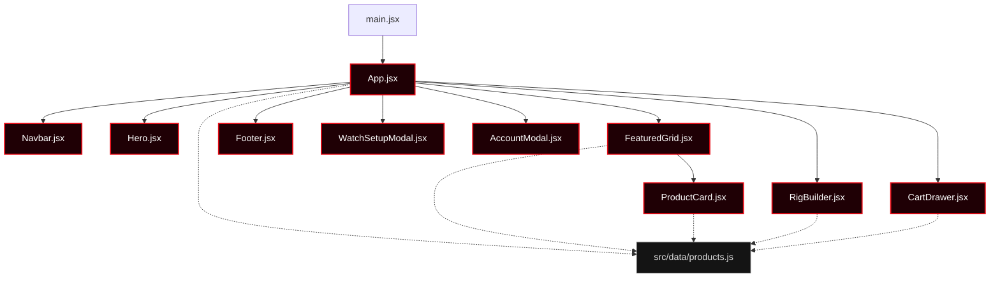
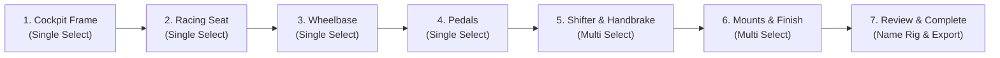
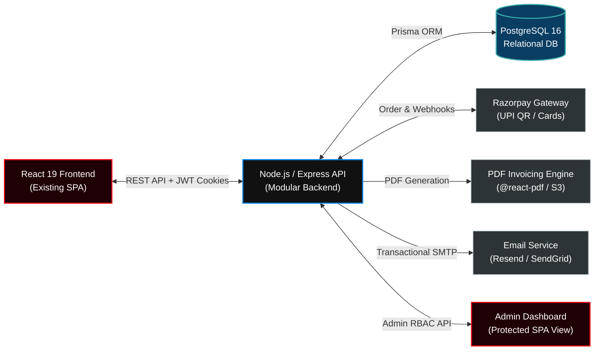
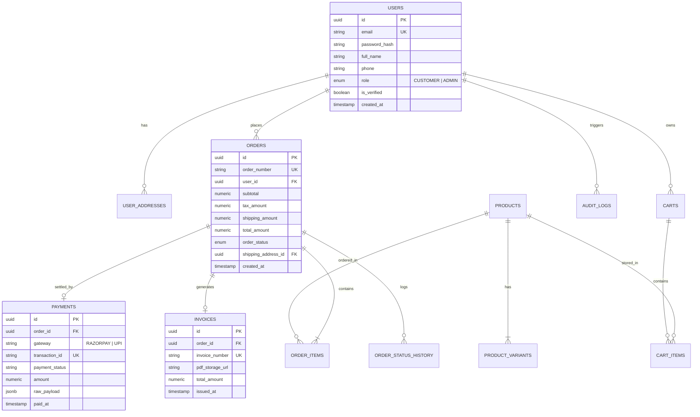
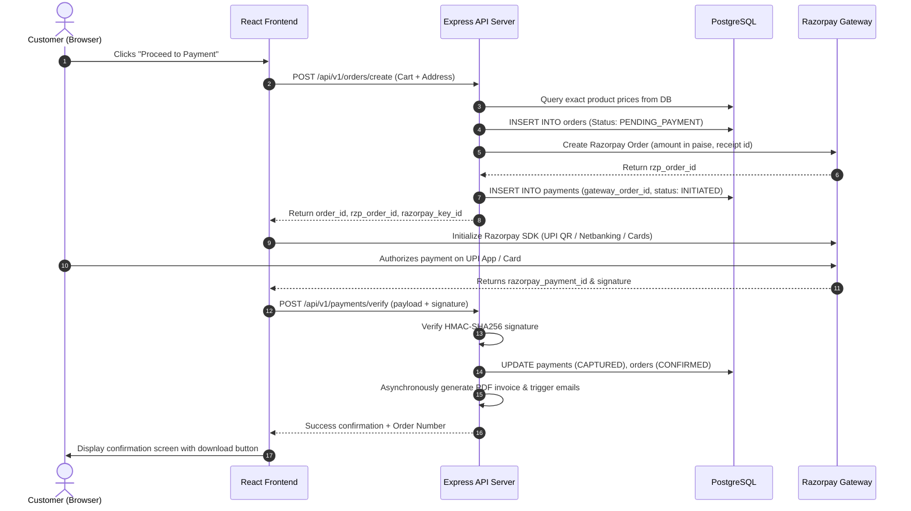
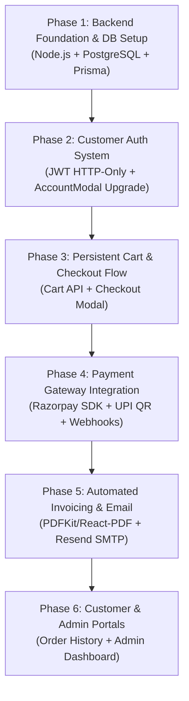

# SLIDESCOIETY — SIM RACING STORE
## Comprehensive Technical Analysis & System Architecture Audit
**Document Version:** 1.0.0  
**Audit Date:** November 16, 2026  
**Auditor Roles:** Senior Full-Stack Software Architect, React 19 Specialist, Database Architect, E-Commerce Systems Engineer, and Lead QA Architect  
**Project:** Slidescoiety Sim Racing Store (Localhost Environment)  
**Target Scope:** Complete pre-implementation audit for Customer Authentication, Order Lifecycle Management, Payment Gateway (Razorpay/UPI), Automated PDF Invoicing, and Admin Management System.

---

> [!IMPORTANT]
> **ANALYSIS-ONLY DIRECTIVE COMPLIANCE**  
> This document is strictly an analysis, audit, and architectural blueprint. No existing code, application files, UI components, styling rules, or business logic were altered, refactored, or disrupted during the execution of this audit.

---

## TABLE OF CONTENTS
1. [A. Executive Summary](#a-executive-summary)
2. [B. Complete Project Architecture](#b-complete-project-architecture)
3. [C. Component Hierarchy & Dependency Map](#c-component-hierarchy--dependency-map)
4. [D. Existing Website Functionality (Section-by-Section)](#d-existing-website-functionality-section-by-section)
5. [E. Build My Setup (Rig Builder) Deep Analysis](#e-build-my-setup-rig-builder-deep-analysis)
6. [F. Shopping Cart & Telemetry Drawer Deep Analysis](#f-shopping-cart--telemetry-drawer-deep-analysis)
7. [G. Authentication & Session Analysis](#g-authentication--session-analysis)
8. [H. Backend & Database Infrastructure Audit](#h-backend--database-infrastructure-audit)
9. [I. New Feature Integration Analysis](#i-new-feature-integration-analysis)
10. [J. Proposed Database Schema (PostgreSQL DDL & ERD)](#j-proposed-database-schema-postgresql-ddl--erd)
11. [K. Proposed API Architecture (RESTful Endpoints)](#k-proposed-api-architecture-restful-endpoints)
12. [L. Payment Gateway Integration Architecture (Razorpay & UPI QR)](#l-payment-gateway-integration-architecture-razorpay--upi-qr)
13. [M. Invoice Generation & Email Notification Architecture](#m-invoice-generation--email-notification-architecture)
14. [N. Customer Dashboard Architecture](#n-customer-dashboard-architecture)
15. [O. Admin Management Dashboard Architecture](#o-admin-management-dashboard-architecture)
16. [P. Existing Functionality Preservation Matrix](#p-existing-functionality-preservation-matrix)
17. [Q. Security & Data Integrity Audit](#q-security--data-integrity-audit)
18. [R. Regression Risk Analysis & Mitigation Strategies](#r-regression-risk-analysis--mitigation-strategies)
19. [S. Phased Implementation Roadmap](#s-phased-implementation-roadmap)
20. [T. Testing, QA Verification & Acceptance Criteria](#t-testing-qa-verification--acceptance-criteria)
21. [U. Critical Architecture Decisions Required Before Implementation](#u-critical-architecture-decisions-required-before-implementation)

---

## A. EXECUTIVE SUMMARY

Slidescoiety is a specialized sim-racing e-commerce storefront presenting professional-grade sim racing chassis (such as the flagship P1-X extruded aluminum chassis), direct-drive wheelbases (up to 25Nm/35Nm), hydraulic load-cell pedal sets, bucket seats, and peripherals.

### Current Implementation State
- **Frontend Architecture:** Modern Single-Page Application (SPA) powered by **React 19.0.0**, **Vite 6.1.0**, and **Tailwind CSS 3.4.17**.
- **Hero Section:** Ultra-HD (3340×1826) studio rig backdrop featuring full-bleed edge-to-edge responsiveness, transparent floating navigation, crisp SVG/vector typography (`P1-X`, `Build Your Own Sim Racing Cockpit`), interactive CTA pills (`Build Yours →`, `▷ Watch Setup`), and carousel controls.
- **Backend Infrastructure:** **0% implemented.** There is currently **no backend server**, no REST/GraphQL API endpoints, no database connection, and no server-side process running.
- **Data Persistence:** **0% implemented.** All catalogue products (16 items) and configurator stages (7 stages) reside in a static in-memory JavaScript file (`src/data/products.js`).
- **State Management:** Local React component state (`useState`) distributed across `App.jsx`, `RigBuilder.jsx`, and `Navbar.jsx`.
- **Cart & Order Processing:** Client-side only. Checkout triggers a browser-generated `.txt` file download containing item strings and estimated totals. No transaction records or orders are persisted.
- **Authentication:** Simulated/Mock UI only. The `AccountModal.jsx` component displays form inputs for email and password that simply trigger a transient toast notification without verifying credentials or generating tokens.

### Strategic Objective
Introduce a production-grade **Node.js/Express API + PostgreSQL database** backplane with **JWT HTTP-Only session authentication**, **Razorpay/UPI payment processing**, **PDF tax invoice generation**, **automated transactional emails**, **Customer Order Portal**, and a **Role-Based Admin Dashboard**, while guaranteeing that **100% of the existing approved visual design, responsive layout, and customer experience remain entirely untouched**.

---

## B. COMPLETE PROJECT ARCHITECTURE

### 1. Technology Stack Inventory

| Component / Layer | Technology | Version | Purpose in Existing Code |
| :--- | :--- | :--- | :--- |
| **Frontend Library** | React | `^19.0.0` | Core UI rendering and reactive component state |
| **DOM Renderer** | React-DOM | `^19.0.0` | Root mounting and virtual DOM synchronization |
| **Bundler / Dev Server** | Vite | `^6.1.0` | Hot Module Replacement (HMR) and optimized rollup production build |
| **Styling Engine** | Tailwind CSS | `^3.4.17` | Utility-first responsive CSS styling |
| **CSS Preprocessing** | PostCSS / Autoprefixer | `^8.5.1` / `^10.4.20` | Vendor prefixing and CSS transformation |
| **Iconography** | Lucide React | `^0.475.0` | SVG icons (`Search`, `ShoppingCart`, `Heart`, `User`, `Play`, etc.) |
| **Type Definitions** | `@types/react`, `@types/react-dom` | `^19.0.0` | TypeScript definitions for editor intellisense |
| **Execution Script** | Windows Batch Script | Custom (`start-localhost.bat`) | Automated browser launch and local dev server startup |

### 2. Complete File & Directory Tree

```
c:\Users\LENOVO\Downloads\slidescoiety-localhost\
├── index.html                                 # HTML5 entrypoint, font preconnects, root mount
├── package.json                               # Dependencies, devDependencies, and npm scripts
├── package-lock.json                          # Pinned dependency resolution tree
├── postcss.config.js                          # PostCSS config (Tailwind + Autoprefixer)
├── tailwind.config.js                         # Custom racing theme colors and font families
├── vite.config.js                             # Vite configuration (port 5500, host: true)
├── start-localhost.bat                        # Windows one-click local server launcher
├── README.md                                  # Local development setup and feature overview
├── public/                                    # Static assets served at web root
│   ├── hero-backdrop-ultra-hd.webp            # 3340x1826 WebP Ultra-HD master backdrop
│   ├── hero-backdrop-ultra-hd.jpg             # 3340x1826 High-Q JPEG fallback backdrop
│   ├── hero-backdrop-hd.jpg                   # Product thumbnail asset for P1-X chassis
│   ├── hero-backdrop-v3.jpg                   # Legacy backdrop iteration asset
│   ├── slidescoiety-logo-hd.png               # High-DPI transparent brand logo
│   ├── slidescoiety-logo-transparent.png      # Transparent brand logo variant
│   └── slidescoiety-s-mark.png                # Isolated red motorsport 'S' brand mark
├── src/                                       # Application source code
│   ├── main.jsx                               # React 19 root bootstrap into #root
│   ├── App.jsx                                # Root application orchestrator, router, global cart
│   ├── index.css                              # Tailwind directives, custom scrollbars, root reset
│   ├── data/
│   │   └── products.js                        # Hardcoded catalogue (16 items), stages, formatters
│   └── components/
│       ├── Navbar.jsx                         # Floating transparent header, dynamic glass scroll
│       ├── Hero.jsx                           # Full-bleed Ultra-HD P1-X motorsport hero section
│       ├── FeaturedGrid.jsx                   # Hardware catalogue grid, search, filter, sort
│       ├── ProductCard.jsx                    # Individual product card, wishlist button, cart CTA
│       ├── RigBuilder.jsx                     # 7-stage custom cockpit configurator & spec sheet
│       ├── CartDrawer.jsx                     # Slide-over cart, quantity controls, simulation order
│       ├── AccountModal.jsx                   # Driver portal modal dialog (mock login)
│       ├── WatchSetupModal.jsx                # 4K chassis assembly guide video modal
│       └── Footer.jsx                         # Global footer with brand mark and navigation links
└── dist/                                      # Production bundle output (built by Vite)
    ├── index.html
    └── assets/
        ├── index-BYjfgWVK.css                 # 33.82 kB compiled CSS bundle
        └── index-CwzTW-CP.js                  # 285.78 kB compiled JS bundle
```

### 3. Environment Variables & Third-Party APIs
- **Environment Files:** None (`.env`, `.env.local`, `.env.production` do not exist).
- **Hardcoded Secrets:** None present.
- **External Image Dependencies:** Several product cards in `src/data/products.js` point to remote image URLs hosted on `images.pexels.com`.
- **Google Fonts:** `index.html` loads *DM Sans* and *Barlow Condensed* via Google Fonts CDN.

---

## C. COMPONENT HIERARCHY & DEPENDENCY MAP



### Detailed Component Communication & Callback Graph

| Component | Parent | Receives (Props) | Emits (Callbacks) | Local State Held |
| :--- | :--- | :--- | :--- | :--- |
| **`App.jsx`** | *Root* | N/A | N/A | `currentView`, `selectedCategory`, `cart`, `wishlist`, `cartOpen`, `watchSetupOpen`, `accountOpen`, `toastMessage`, `toastVisible` |
| **`Navbar.jsx`** | `App.jsx` | `currentView`, `cartCount`, `wishlistCount` | `onNavigate(view, cat)`, `onOpenCart()`, `onOpenSearch()`, `onOpenAccount()`, `onOpenWishlist()` | `mobileOpen` (drawer), `shopDropdown`, `scrolled` (scrollY > 20) |
| **`Hero.jsx`** | `App.jsx` | N/A | `onBuildClick()`, `onWatchSetupClick()`, `onShowToast(msg)` | `currentSlide` (0..2) |
| **`FeaturedGrid.jsx`**| `App.jsx` | `wishlist`, `selectedCategory`, `isFullShop` | `onAddToCart(id)`, `onToggleWishlist(id)`, `onOpenDetail(id)`, `onSelectCategory(cat)`, `onNavigateToShop()` | `searchQuery`, `priceFilter`, `sortBy` |
| **`ProductCard.jsx`** | `FeaturedGrid.jsx` | `product`, `isWishlisted` | `onAddToCart(id)`, `onToggleWishlist(id)`, `onOpenDetail(id)` | None (pure presentation) |
| **`RigBuilder.jsx`** | `App.jsx` | N/A | `onAddToCart(id, qty)`, `onShowToast(msg)` | `step` (0..6), `build` (dict of selected IDs), `buildName` |
| **`CartDrawer.jsx`** | `App.jsx` | `isOpen`, `cart` | `onClose()`, `onUpdateQty(id, delta)`, `onClearCart()`, `onShowToast(msg)` | None (derived calculations) |
| **`AccountModal.jsx`**| `App.jsx` | `isOpen` | `onClose()`, `onShowToast(msg)` | `email`, `password` |
| **`WatchSetupModal.jsx`**| `App.jsx` | `isOpen` | `onClose()`, `onGoToBuilder()` | None |
| **`Footer.jsx`** | `App.jsx` | N/A | `onNavigate(view, cat)` | None |

---

## D. EXISTING WEBSITE FUNCTIONALITY (SECTION-BY-SECTION)

### 1. Homepage (`App.jsx` where `currentView === 'home'`)
- **Status:** **Fully Functional (Presentation & Navigation)**
- **Structure:** Sequentially mounts `Hero.jsx`, `FeaturedGrid.jsx` (with `isFullShop={false}` showing 6 top items), and a static 3-column callout card section (`01 // CHASSIS FOUNDATION`, `02 // DIRECT DRIVE COUPLING`, `03 // LOAD-CELL RIGIDITY`).
- **Dependencies:** Sub-components and local router state in `App.jsx`.

### 2. Navbar (`src/components/Navbar.jsx`)
- **Status:** **Fully Functional**
- **Visual Design:** Floating transparent navigation header when at the top of the homepage (`currentView === 'home' && !scrolled`), automatically transitioning to `bg-[#080002]/90 backdrop-blur-md` with border upon scrolling or when navigating to `/shop` or `/builder`.
- **Interactions:**
  - `Slidescoiety` logo: Navigates to `home`.
  - `Home`: Switches view to `home`.
  - `Shop`: Hover dropdown with 6 sub-categories; clicking any filters the shop catalogue.
  - `Cockpits`, `Accessories`, `Bundles`: Directly routes to `shop` with pre-selected category.
  - `Build My Setup`: Routes to `builder`.
  - Search Icon: Switches view to `shop` and opens search focus.
  - Heart Icon: Shows toast with current wishlist count.
  - Cart Icon: Shows red badge counter (`cartTotalCount`) and opens `CartDrawer`.
  - Account Button: Opens `AccountModal`.
  - Mobile Menu Toggle: Hamburger icon triggering responsive slide-down menu on viewports `< 1024px`.

### 3. Hero Section (`src/components/Hero.jsx`)
- **Status:** **Fully Functional (Approved Master Design)**
- **Visual Design:** Full-bleed edge-to-edge motorsport showroom atmosphere. Uses WebP/JPEG 3340×1826 master backdrop (`/hero-backdrop-ultra-hd.webp`) with extended vertical gradient headroom.
- **Elements:**
  - Vector kicker: `BUILD / RACE / UPGRADE`.
  - Heading: Ultra-bold italic `P1-X`.
  - Subtitle: `Build Your Own Sim Racing Cockpit`.
  - Primary CTA Button: `Build Yours →` (executes `onBuildClick`, transitioning router to `builder`).
  - Secondary CTA Button: `▷ Watch Setup` (executes `onWatchSetupClick`, opening setup guide modal).
  - Bottom-Right Carousel: 3 indicator pills and `<` `>` arrow navigation buttons that cycle slide state and trigger transient toast telemetry alerts.

### 4. Featured Products Grid (`src/components/FeaturedGrid.jsx`)
- **Status:** **Fully Functional**
- **Modes:**
  - Homepage Mode (`isFullShop={false}`): Displays the first 6 items from `src/data/products.js` with an "Explore All Hardware →" link.
  - Full Shop Mode (`isFullShop={true}`): Displays complete catalogue (16 items) with interactive live search input, price range filter dropdown (`all`, `<20k`, `20k-60k`, `>60k`), sort dropdown (`featured`, `price low-to-high`, `price high-to-low`, `highest rated`), and 12 horizontal category filter pills.
- **Data Source:** Static array `products` imported from `src/data/products.js`.

### 5. Product Card (`src/components/ProductCard.jsx`)
- **Status:** **Fully Functional**
- **Features:** 4:3 aspect-ratio image container with zoom-on-hover effect, category badge, rating display (`/ 5.0 DEMO`), product title, specification summary, localized Indian Rupee price formatting (`₹`), interactive heart button (adds/removes from wishlist array), and "Add to Cart" button (disabled if `product.available === false`).

### 6. Cockpit Categories, Accessories & Bundles
- **Status:** **Fully Functional via In-Memory Filtering**
- Handled dynamically inside `FeaturedGrid.jsx` by filtering `products` against `p.cat === selectedCategory`. The categories include:
  - Cockpit frames (`frame-x`, `frame-s`, `frame-p`)
  - Racing seats (`seat`, `seat-lite`)
  - Wheel bases (`wheel`)
  - Pedals (`pedals`, `pedals-pro`)
  - Shifters & Handbrakes (`shifter`, `handbrake`)
  - Monitor mounts, Trays, Cable kits, Motion systems, and Turn-key Bundles (`bundle-s`, `bundle-p`).

### 7. Watch Setup Walkthrough Modal (`src/components/WatchSetupModal.jsx`)
- **Status:** **Fully Functional**
- Fixed full-screen modal overlay with glass backdrop, video thumbnail simulation for P1-X assembly, 3 engineering specification pillars (Chassis Build, Wheel Deck 35Nm, Pedal Incline), and a "Configure Rig →" redirect button.

### 8. Footer (`src/components/Footer.jsx`)
- **Status:** **Fully Functional**
- Dark background (`#070001`), crisp brand logo, legal/demo notice, and navigation links.

---

## E. BUILD MY SETUP (RIG BUILDER) DEEP ANALYSIS

The Rig Builder (`src/components/RigBuilder.jsx`) is the core customer acquisition engine of the site. It guides customers through a 7-stage custom cockpit assembly workflow.

### 1. Stage Configuration Workflow



| Stage Index | Stage Name | Selection Rule | Component IDs Available |
| :--- | :--- | :--- | :--- |
| **0** | Cockpit Frame | Single (`multi: false`) | `frame-x` (₹1,32,450), `frame-p` (₹54,999), `frame-s` (₹34,999) |
| **1** | Racing Seat | Single (`multi: false`) | `seat` (₹24,999), `seat-lite` (₹42,999) |
| **2** | Wheelbase | Single (`multi: false`) | `wheel` (₹84,999) |
| **3** | Pedals | Single (`multi: false`) | `pedals` (₹48,999), `pedals-pro` (₹89,999) |
| **4** | Shifter & Handbrake | Multi (`multi: true`) | `shifter` (₹18,999), `handbrake` (₹13,999) |
| **5** | Mounts & Finish | Multi (`multi: true`) | `display` (₹22,999), `tray` (₹7,499), `cable` (₹3,499), `motion` (₹2,45,000) |
| **6** | Review & Complete | Build Summary | Form input for `buildName`, Download Spec Sheet, Add Rig to Cart |

### 2. State Structure & Cart Data Transfer

```javascript
// Local state in RigBuilder.jsx:
const [step, setStep] = useState(0);
const [build, setBuild] = useState({
  'frame-x': true,
  'seat-lite': true,
  'wheel': true,
  'pedals-pro': true
});
const [buildName, setBuildName] = useState('Apex Championship GT3');
```

#### How Build Items Are Transferred to Cart:
When the user clicks `"Add Rig to Cart"` or `"Add Configured Rig to Cart"`:
```javascript
const handleAddBuildToCart = () => {
  selectedItems.forEach((p) => onAddToCart(p.id, 1));
  onShowToast?.(`Added configured ${buildName} rig to your cart`);
};
```
Where `onAddToCart` is defined in `App.jsx`:
```javascript
const handleAddToCart = (id, qty = 1) => {
  setCart((prev) => ({
    ...prev,
    [id]: (prev[id] || 0) + qty
  }));
};
```

### 3. Critical Architectural Limitations of Existing Builder
1. **Dismantling of the Custom Rig Entity:** The custom rig configuration does not exist as a standalone entity in the cart. Instead, the component iterates over `selectedItems` and adds each component as an independent product ID. The association between components (and the custom `buildName`) is completely discarded once added to the cart.
2. **Component Unmount Volatility:** `build` state is strictly local to `RigBuilder.jsx`. If the user navigates away from `builder` to `shop` or `home` and returns, the `RigBuilder` component unmounts and remounts, resetting the user's customized rig back to the hardcoded default (`frame-x`, `seat-lite`, `wheel`, `pedals-pro`).
3. **No LocalStorage or Session Persistence:** Refreshing the page, closing the tab, or changing routes wipes all user selections.
4. **No True Compatibility Enforcement:** Compatibility rules are descriptive strings in `products.js` (`compat`) rather than programmatically enforced validation matrices (e.g., motion systems allowing selection on unsupported compact frames).

---

## F. SHOPPING CART & TELEMETRY DRAWER DEEP ANALYSIS

The shopping cart is managed via `src/components/CartDrawer.jsx` and synchronized globally through `App.jsx`.

### 1. Cart State & Data Schema
In `App.jsx`:
```javascript
const [cart, setCart] = useState({ 'frame-x': 1, 'pedals-pro': 1 }); // Pre-loaded demo items
```
The cart is stored as a simple key-value dictionary mapping `productId` (string) to `quantity` (number).

### 2. Line Item & Total Calculation
In `CartDrawer.jsx`:
```javascript
const items = Object.entries(cart)
  .filter(([_, qty]) => qty > 0)
  .map(([id, qty]) => {
    const product = byId(id);
    return product ? { ...product, qty } : null;
  })
  .filter(Boolean);

const subtotal = items.reduce((acc, item) => acc + item.price * item.qty, 0);
const shipping = items.length > 0 ? (subtotal >= 50000 ? 0 : 1500) : 0;
const total = subtotal + shipping;
```

### 3. Quantity Operations
- **Increment:** `onUpdateQty(id, 1)` adds 1.
- **Decrement:** `onUpdateQty(id, -1)` subtracts 1; when `newQty <= 0`, the key is removed from the state object.
- **Trash Button:** `onUpdateQty(id, -item.qty)` immediately removes the item.

### 4. Existing Checkout Execution Path
Clicking `"Checkout / Download Order Summary"` executes `handleCheckout()`:
```javascript
const handleCheckout = () => {
  const text = [
    '================================================',
    'SLIDESCOIETY SIM RACING STORE — DEMO ORDER SUMMARY',
    `Date: ${new Date().toLocaleDateString()}`,
    ...items.map((it) => `${it.name} (x${it.qty}) — ${fmt(it.price * it.qty)}`),
    `Subtotal: ${fmt(subtotal)}`,
    `Shipping: ${shipping === 0 ? 'FREE' : fmt(shipping)}`,
    `Estimated Order Total: ${fmt(total)}`,
    '================================================',
    'Note: This is an illustrative simulation order. No real payment or delivery is initiated.'
  ].join('\n');

  const blob = new Blob([text], { type: 'text/plain' });
  const url = URL.createObjectURL(blob);
  const link = document.createElement('a');
  link.href = url;
  link.download = `slidescoiety-order-${Date.now()}.txt`;
  link.click();
  URL.revokeObjectURL(url);
  onShowToast?.('Demo order summary downloaded successfully');
};
```

### 5. Architectural Findings
- **No Order Record:** No database record or API call is triggered.
- **No Address Collection:** No customer shipping, billing, or GST details are requested.
- **Vulnerable to Price Tampering:** Prices are taken directly from the client-side JavaScript object.
- **Initial State Polluted:** The cart defaults to having 2 pre-selected items (`frame-x` and `pedals-pro`) on every fresh application load.

---

## G. AUTHENTICATION & SESSION ANALYSIS

### Current State: **Simulation Only (0% Actual Auth)**

The file `src/components/AccountModal.jsx` contains:
```javascript
const [email, setEmail] = useState('');
const [password, setPassword] = useState('');

const handleSubmit = (e) => {
  e.preventDefault();
  onShowToast?.(`Signed in as ${email || 'Driver'} (demo session)`);
  onClose();
};
```

### Gap Analysis
| Required Production Auth Feature | Currently Implemented? | Existing Code Found |
| :--- | :--- | :--- |
| Customer Registration / Sign Up | **NO** | None (only a simulated sign-in form) |
| Password Hashing (bcrypt/argon2) | **NO** | None |
| JWT Token Generation & Verification | **NO** | None |
| HTTP-Only Cookie Storage | **NO** | None |
| Session Expiration & Refresh Flow | **NO** | None |
| Password Reset / Forgot Password | **NO** | None |
| Email Verification Link | **NO** | None |
| Role-Based Authorization (Admin vs Customer) | **NO** | None |
| User Profile Management | **NO** | None |

---

## H. BACKEND & DATABASE INFRASTRUCTURE AUDIT

An exhaustive audit of the root directory and all dependencies confirms:

| Infrastructure Layer | Expected Implementation | Actual Existing State |
| :--- | :--- | :--- |
| **Backend Server** | Node.js Express / NestJS / FastAPI | **NONE.** No backend script or server exists. |
| **Database** | PostgreSQL / MySQL / MongoDB | **NONE.** No database engine, ORM, or migration scripts exist. |
| **API Endpoints** | `/api/v1/*` routes | **NONE.** All data operations are in-memory. |
| **Object Storage** | AWS S3 / Cloudflare R2 | **NONE.** Images are stored in `/public` or hotlinked from Pexels. |
| **Transactional Email** | SendGrid / Resend / AWS SES | **NONE.** |
| **Payment Gateway** | Razorpay / Stripe SDKs | **NONE.** |
| **PDF Generation Engine** | Puppeteer / `@react-pdf` / PDFKit | **NONE.** |

---

## I. NEW FEATURE INTEGRATION ANALYSIS

To integrate full customer authentication, order management, payment processing, invoicing, and admin controls **WITHOUT** disturbing existing visual designs or layouts:



### 1. Integration Strategy by Module

#### A. Customer Authentication Integration
- **Preserve Existing UI:** Upgrade `src/components/AccountModal.jsx` into a tabbed modal (Sign In / Register / Forgot Password) maintaining the exact red-and-black aesthetic (`#0f0003` background, `#e50914` accents).
- **Session State:** Introduce an `AuthContext.jsx` that exposes `user`, `isAuthenticated`, `login()`, `logout()`, and `register()`.
- **Navbar Integration:** Update the "Account" button in `Navbar.jsx` to display the authenticated user's name or a driver avatar pill when logged in, opening a dropdown with `"My Dashboard"`, `"My Orders"`, and `"Sign Out"`.

#### B. Checkout Flow Integration
- **Preserve Cart Drawer:** In `CartDrawer.jsx`, change the action of the Checkout button from downloading a `.txt` file to checking `isAuthenticated`.
  - If authenticated: Opens a streamlined slide-over or dedicated view `CheckoutModal.jsx` collecting shipping address, state, postal code, and GSTIN (optional).
  - If unauthenticated: Opens `AccountModal.jsx` with an active return flag to automatically reopen checkout upon successful authentication.
- **Custom Rig Integrity:** Add an optional `customRig` payload to cart items so configurations built in `RigBuilder.jsx` retain their custom name and sub-assembly associations inside order line items.

#### C. Payment Integration (Razorpay & UPI QR)
- **Workflow:**
  1. Frontend sends cart and delivery address to `POST /api/v1/orders/create`.
  2. Backend calculates prices from the database (preventing client manipulation), inserts an order with status `PENDING_PAYMENT`, and generates a Razorpay Order ID.
  3. Frontend initializes Razorpay Checkout modal (or displays an embedded UPI dynamic QR code).
  4. Upon successful payment, Razorpay webhooks (`order.paid` and `payment.authorized`) verify signature on the backend via HMAC-SHA256.
  5. Backend updates order status to `CONFIRMED` and triggers invoice generation.

#### D. Automated PDF Invoice Engine
- **Specifications:** Generate standard GST-compliant tax invoices using `@react-pdf/renderer` or `pdfkit`.
- **Sequential Invoicing:** Unique numbering format (e.g., `INV-2026-0001`).
- **Data Embedded:** Company details, customer billing & shipping addresses, SAC/HSN codes, itemized breakdown, CGST/SGST/IGST breakdown, total in INR, and Razorpay payment ID.
- **Delivery:** Downloadable from Customer Dashboard and automatically attached to the order confirmation email.

#### E. Transactional Email Engine
- Integrated via **Resend** or **SendGrid** with HTML email templates styled with Slidescoiety's motorsport branding:
  - `Order Confirmation` (with attached PDF invoice).
  - `Payment Received Alert`.
  - `Order Dispatched & Tracking Link`.
  - `Admin Alert: New High-Value Sim Rig Order Placed`.

#### F. Customer & Admin Dashboards
- **Customer Dashboard View (`currentView === 'account'`):** Displays profile settings, order history, live order statuses (`PENDING`, `CONFIRMED`, `FABRICATING`, `DISPATCHED`, `DELIVERED`), and one-click PDF invoice downloads.
- **Admin Dashboard (`currentView === 'admin'` or `/admin`):** Protected by `role === 'ADMIN'`. Features revenue telemetry, order status management, inventory counters, payment verification audit logs, and customer lookup.

---

## J. PROPOSED DATABASE SCHEMA (POSTGRESQL DDL & ERD)

### 1. Entity-Relationship Diagram (ERD)



### 2. Complete PostgreSQL DDL Script

```sql
-- Slidescoiety Sim Racing Store Database Schema (PostgreSQL 16)

CREATE EXTENSION IF NOT EXISTS "uuid-ossp";

-- User Roles
CREATE TYPE user_role AS ENUM ('CUSTOMER', 'ADMIN', 'SUPPORT');

-- Order Statuses
CREATE TYPE order_status_enum AS ENUM (
    'PENDING_PAYMENT',
    'CONFIRMED',
    'FABRICATING',
    'SHIPPED',
    'DELIVERED',
    'CANCELLED',
    'REFUNDED'
);

-- Payment Statuses
CREATE TYPE payment_status_enum AS ENUM (
    'INITIATED',
    'AUTHORIZED',
    'CAPTURED',
    'FAILED',
    'REFUNDED'
);

-- Users Table
CREATE TABLE users (
    id UUID PRIMARY KEY DEFAULT uuid_generate_v4(),
    email VARCHAR(255) UNIQUE NOT NULL,
    password_hash VARCHAR(255) NOT NULL,
    full_name VARCHAR(150) NOT NULL,
    phone VARCHAR(20),
    role user_role DEFAULT 'CUSTOMER' NOT NULL,
    is_verified BOOLEAN DEFAULT FALSE NOT NULL,
    verification_token VARCHAR(255),
    reset_password_token VARCHAR(255),
    reset_password_expires TIMESTAMP WITH TIME ZONE,
    created_at TIMESTAMP WITH TIME ZONE DEFAULT CURRENT_TIMESTAMP NOT NULL,
    updated_at TIMESTAMP WITH TIME ZONE DEFAULT CURRENT_TIMESTAMP NOT NULL
);

-- User Addresses
CREATE TABLE user_addresses (
    id UUID PRIMARY KEY DEFAULT uuid_generate_v4(),
    user_id UUID NOT NULL REFERENCES users(id) ON DELETE CASCADE,
    address_type VARCHAR(50) DEFAULT 'SHIPPING', -- SHIPPING, BILLING
    recipient_name VARCHAR(150) NOT NULL,
    phone VARCHAR(20) NOT NULL,
    street_line1 VARCHAR(255) NOT NULL,
    street_line2 VARCHAR(255),
    city VARCHAR(100) NOT NULL,
    state VARCHAR(100) NOT NULL,
    postal_code VARCHAR(20) NOT NULL,
    country VARCHAR(100) DEFAULT 'India' NOT NULL,
    is_default BOOLEAN DEFAULT FALSE,
    created_at TIMESTAMP WITH TIME ZONE DEFAULT CURRENT_TIMESTAMP NOT NULL
);

-- Product Catalogue (Synchronized from src/data/products.js)
CREATE TABLE products (
    id VARCHAR(100) PRIMARY KEY, -- e.g. 'frame-x', 'wheel', 'pedals-pro'
    name VARCHAR(255) NOT NULL,
    category VARCHAR(100) NOT NULL,
    price_inr NUMERIC(12, 2) NOT NULL,
    price_eur_display VARCHAR(50),
    spec_description TEXT NOT NULL,
    compatibility_notes TEXT,
    rating NUMERIC(3, 2) DEFAULT 5.0,
    is_available BOOLEAN DEFAULT TRUE NOT NULL,
    stock_quantity INT DEFAULT 50 NOT NULL,
    image_url TEXT NOT NULL,
    created_at TIMESTAMP WITH TIME ZONE DEFAULT CURRENT_TIMESTAMP NOT NULL,
    updated_at TIMESTAMP WITH TIME ZONE DEFAULT CURRENT_TIMESTAMP NOT NULL
);

-- Product Variants (Optional accessories, brackets, colorways)
CREATE TABLE product_variants (
    id UUID PRIMARY KEY DEFAULT uuid_generate_v4(),
    product_id VARCHAR(100) NOT NULL REFERENCES products(id) ON DELETE CASCADE,
    variant_name VARCHAR(100) NOT NULL,
    price_modifier NUMERIC(10, 2) DEFAULT 0.00,
    sku VARCHAR(100) UNIQUE,
    stock_quantity INT DEFAULT 20 NOT NULL
);

-- Persistent Carts
CREATE TABLE carts (
    id UUID PRIMARY KEY DEFAULT uuid_generate_v4(),
    user_id UUID REFERENCES users(id) ON DELETE CASCADE,
    session_id VARCHAR(255) UNIQUE, -- For guest cart persistence
    created_at TIMESTAMP WITH TIME ZONE DEFAULT CURRENT_TIMESTAMP NOT NULL,
    updated_at TIMESTAMP WITH TIME ZONE DEFAULT CURRENT_TIMESTAMP NOT NULL
);

CREATE TABLE cart_items (
    id UUID PRIMARY KEY DEFAULT uuid_generate_v4(),
    cart_id UUID NOT NULL REFERENCES carts(id) ON DELETE CASCADE,
    product_id VARCHAR(100) NOT NULL REFERENCES products(id),
    quantity INT DEFAULT 1 NOT NULL,
    custom_rig_name VARCHAR(150),
    created_at TIMESTAMP WITH TIME ZONE DEFAULT CURRENT_TIMESTAMP NOT NULL,
    CONSTRAINT unique_cart_product UNIQUE (cart_id, product_id, custom_rig_name)
);

-- Orders
CREATE TABLE orders (
    id UUID PRIMARY KEY DEFAULT uuid_generate_v4(),
    order_number VARCHAR(50) UNIQUE NOT NULL, -- e.g. 'SLIDE-2026-1001'
    user_id UUID NOT NULL REFERENCES users(id),
    shipping_address_id UUID REFERENCES user_addresses(id),
    subtotal NUMERIC(12, 2) NOT NULL,
    tax_amount NUMERIC(12, 2) DEFAULT 0.00 NOT NULL,
    shipping_amount NUMERIC(12, 2) DEFAULT 0.00 NOT NULL,
    total_amount NUMERIC(12, 2) NOT NULL,
    status order_status_enum DEFAULT 'PENDING_PAYMENT' NOT NULL,
    notes TEXT,
    created_at TIMESTAMP WITH TIME ZONE DEFAULT CURRENT_TIMESTAMP NOT NULL,
    updated_at TIMESTAMP WITH TIME ZONE DEFAULT CURRENT_TIMESTAMP NOT NULL
);

-- Order Items (Snapshot of products at time of purchase)
CREATE TABLE order_items (
    id UUID PRIMARY KEY DEFAULT uuid_generate_v4(),
    order_id UUID NOT NULL REFERENCES orders(id) ON DELETE CASCADE,
    product_id VARCHAR(100) NOT NULL REFERENCES products(id),
    product_name VARCHAR(255) NOT NULL,
    unit_price NUMERIC(12, 2) NOT NULL,
    quantity INT NOT NULL,
    line_total NUMERIC(12, 2) NOT NULL,
    custom_rig_name VARCHAR(150),
    created_at TIMESTAMP WITH TIME ZONE DEFAULT CURRENT_TIMESTAMP NOT NULL
);

-- Payments (Razorpay / UPI Records)
CREATE TABLE payments (
    id UUID PRIMARY KEY DEFAULT uuid_generate_v4(),
    order_id UUID NOT NULL REFERENCES orders(id) ON DELETE CASCADE,
    payment_gateway VARCHAR(50) DEFAULT 'RAZORPAY' NOT NULL,
    gateway_order_id VARCHAR(255) NOT NULL, -- Razorpay order_id
    gateway_payment_id VARCHAR(255) UNIQUE, -- Razorpay payment_id
    gateway_signature VARCHAR(255),
    amount NUMERIC(12, 2) NOT NULL,
    currency VARCHAR(10) DEFAULT 'INR' NOT NULL,
    status payment_status_enum DEFAULT 'INITIATED' NOT NULL,
    method VARCHAR(50), -- upi, card, netbanking
    raw_response JSONB,
    paid_at TIMESTAMP WITH TIME ZONE,
    created_at TIMESTAMP WITH TIME ZONE DEFAULT CURRENT_TIMESTAMP NOT NULL
);

-- Invoices
CREATE TABLE invoices (
    id UUID PRIMARY KEY DEFAULT uuid_generate_v4(),
    order_id UUID UNIQUE NOT NULL REFERENCES orders(id) ON DELETE CASCADE,
    invoice_number VARCHAR(50) UNIQUE NOT NULL, -- e.g. 'INV-2026-0001'
    pdf_url TEXT,
    total_amount NUMERIC(12, 2) NOT NULL,
    tax_breakdown JSONB,
    issued_at TIMESTAMP WITH TIME ZONE DEFAULT CURRENT_TIMESTAMP NOT NULL
);

-- Order Status Audit History
CREATE TABLE order_status_history (
    id UUID PRIMARY KEY DEFAULT uuid_generate_v4(),
    order_id UUID NOT NULL REFERENCES orders(id) ON DELETE CASCADE,
    previous_status order_status_enum,
    new_status order_status_enum NOT NULL,
    changed_by_user_id UUID REFERENCES users(id),
    notes TEXT,
    created_at TIMESTAMP WITH TIME ZONE DEFAULT CURRENT_TIMESTAMP NOT NULL
);
```

---

## K. PROPOSED API ARCHITECTURE (RESTFUL ENDPOINTS)

All endpoints follow RESTful standards with JSON payloads and standard HTTP status codes.

```
/api/v1
├── /auth
│   ├── POST   /register                 # Customer registration
│   ├── POST   /login                    # Sign in & issue HTTP-Only JWT
│   ├── POST   /logout                   # Clear auth cookies
│   ├── GET    /me                       # Fetch current authenticated user & role
│   ├── POST   /forgot-password          # Trigger reset email
│   └── POST   /reset-password           # Finalize password reset with token
│
├── /products
│   ├── GET    /                         # Catalogue with filtering, category, sorting
│   └── GET    /:id                      # Product detail & inventory status
│
├── /cart
│   ├── GET    /                         # Fetch user's persistent cart
│   ├── POST   /items                    # Add item (with optional rig name)
│   ├── PATCH  /items/:id                # Update quantity
│   └── DELETE /items/:id                # Remove item
│
├── /orders
│   ├── POST   /create                   # Create pending order & Razorpay order
│   ├── GET    /my-orders                # Customer's order history
│   ├── GET    /:id                      # Order details & line items
│   └── GET    /:id/invoice              # Secure download stream of PDF invoice
│
├── /payments
│   ├── POST   /verify                   # Verify Razorpay signature (client callback)
│   └── POST   /webhook                  # Asynchronous Razorpay webhook listener
│
└── /admin (Protected: role === 'ADMIN')
    ├── GET    /analytics/summary        # Revenue telemetry, active orders, conversion
    ├── GET    /orders                   # Complete multi-filter order list
    ├── PATCH  /orders/:id/status        # Transition order status & trigger email
    ├── GET    /customers                # Customer management list
    ├── PATCH  /inventory/:productId     # Update stock levels
    └── GET    /invoices                 # Regenerate or audit invoices
```

---

## L. PAYMENT GATEWAY INTEGRATION ARCHITECTURE (RAZORPAY & UPI QR)



### Webhook Resilience & Duplicate Prevention
- **Webhook Endpoint:** `POST /api/v1/payments/webhook`.
- Validates `X-Razorpay-Signature` against the configured webhook secret.
- **Idempotency:** Checks if `gateway_payment_id` has already been captured. If already captured, returns `HTTP 200 OK` immediately without double-counting revenue or duplicating invoice generation.

---

## M. INVOICE GENERATION & EMAIL ARCHITECTURE

### 1. Invoice Specifications
- **Tooling:** `@react-pdf/renderer` executing in Node.js worker.
- **Numbering Algorithm:** Thread-safe database sequence: `INV-` + `YYYY` + `-` + `LPAD(seq, 5, '0')` (e.g. `INV-2026-00042`).
- **GST Compliance:**
  - Registered Legal Name: **Slidescoiety Sim Racing Store Private Limited**
  - SAC Code: `9987` (Sim Racing Assemblies & Hardware) / HSN Code: `9504`
  - Tax calculation: 18% GST (9% CGST + 9% SGST for intra-state; 18% IGST for inter-state shipments).
- **Storage:** Saved locally in `/storage/invoices` or Cloudflare R2 / AWS S3 with signed URLs.

### 2. Transactional Email Matrix

| Trigger Event | Recipient | Subject Line | Attachments |
| :--- | :--- | :--- | :--- |
| **Order Placed & Paid** | Customer | `Order Confirmed: P1-X Hardware (Ref: SLIDE-2026-XXXX)` | `INV-2026-XXXX.pdf` |
| **New Order Alert** | Store Admin | `[ALERT] New Hardware Order #SLIDE-2026-XXXX Received` | Order Spec Sheet |
| **Chassis Shipped** | Customer | `Your Slidescoiety Sim Rig is on the Way! Tracking Inside` | None |
| **Payment Failed** | Customer | `Action Required: Payment Incomplete for Order #XXXX` | Retry Link |

---

## N. CUSTOMER DASHBOARD ARCHITECTURE

The Customer Dashboard is mounted inside `App.jsx` when `currentView === 'account'` (for authenticated customers).

### Visual Layout
Maintains the exact Slidescoiety racing theme:
- **Header:** Driver telemetry bar displaying Driver Name, Email, Total Rigs Configured, and Total Orders.
- **Navigation Tabs:**
  1. `My Orders`: Card list of past orders with real-time status pills (`CONFIRMED`, `FABRICATING`, `SHIPPED`). Includes item breakdown and `"Download Tax Invoice (PDF)"` button.
  2. `Saved Rigs`: Configurations saved directly from the `RigBuilder`.
  3. `Shipping Addresses`: Manage saved delivery locations.
  4. `Security`: Password update and active session management.

---

## O. ADMIN MANAGEMENT DASHBOARD ARCHITECTURE

The Admin Portal is a protected workspace accessible only when the authenticated user possesses `role === 'ADMIN'`.

### Features
1. **Telemetry Analytics Cards:**
   - Total Gross Revenue (INR)
   - Completed Orders vs Pending Payments
   - Average Order Value (AOV)
   - Top-Selling Chassis (`P1-X` vs `Vector P` vs `Vector S`)
2. **Order Management Table:**
   - Filter by status, customer, date range, or payment gateway.
   - Live status transition modal (`PENDING` → `CONFIRMED` → `FABRICATING` → `SHIPPED` → `DELIVERED`).
   - Customer shipping label generation.
3. **Inventory & Stock Controller:**
   - Direct toggles for `is_available` and stock counters.
4. **Audit Logs:**
   - Complete audit trail of price changes, manual order overrides, and refund records.

---

## P. EXISTING FUNCTIONALITY PRESERVATION MATRIX

| Existing Section / File | Current Role | Regression Risk During Backend Addition | Strict Preservation Strategy | Verification Method |
| :--- | :--- | :--- | :--- | :--- |
| **`Hero.jsx`** | Full-bleed Ultra-HD P1-X hero section | High (layout breaks if parent styling or routing changes) | **DO NOT TOUCH.** Keep all CSS classes, WebP assets, and callbacks (`onBuildClick`, `onWatchSetupClick`) identical. | Screenshot diffing at 1920×1080 and 1536×864. |
| **`Navbar.jsx`** | Transparent & dynamic glass header | Medium (account button behavior changes) | Keep exact visual classes (`h-16 sm:h-[70px]`, `fixed top-0`). Only attach a user menu dropdown to the existing Account button. | Visual inspection on desktop and mobile. |
| **`RigBuilder.jsx`** | 7-stage custom cockpit configurator | High (custom build state must not break) | Preserve existing local stage navigation and `.txt` export. Enhance `handleAddBuildToCart` to pass rig metadata seamlessly. | Step through all 7 stages and verify live estimate calculation. |
| **`CartDrawer.jsx`** | Slide-out cart & order summary | Medium (checkout action transition) | Maintain drawer layout, animations, item cards, and quantity controls. Replace simulation text download with checkout modal trigger. | Add multiple items, adjust quantities, verify subtotal and shipping math. |
| **`FeaturedGrid.jsx`** | Product catalogue, search, filters | Low | Maintain existing filter pills and search inputs. Feed catalogue dynamically while falling back to `products.js`. | Verify search, category pills, and sorting functionality. |
| **`ProductCard.jsx`** | Product card with wishlist & add-to-cart | Low | Zero visual changes. Ensure `onAddToCart` and `onToggleWishlist` callbacks remain intact. | Click card, toggle wishlist heart, click "Add to Cart". |
| **`index.css` / Tailwind** | Theme styling and fonts | High (global style collisions) | Do not modify existing theme colors (`racing.red`, `racing.dark`, `DM Sans`, `Barlow Condensed`). | Ensure global typography and dark background stay intact. |

---

## Q. SECURITY & DATA INTEGRITY AUDIT

### Identified Vulnerabilities in Existing Implementation
1. **Client-Side Pricing Trust:** Currently, prices and totals are calculated entirely in the browser. In the new system, **the backend must recalculate every line item and total from the database**.
2. **Plaintext Memory State:** Cart and custom builds reside in volatile JavaScript variables without sanitization.
3. **No Authentication Boundary:** The existing `AccountModal.jsx` accepts any email/password and closes itself without validation.

### Security Architecture for Implementation
- **Password Security:** Use **Argon2id** or **bcrypt** with a minimum work factor of 12.
- **Session Tokens:** Issue JWTs signed with `RS256` or `HS512` stored **strictly in HTTP-Only, Secure, SameSite=Strict cookies**. Never store authentication tokens in `localStorage`.
- **Payment Verification:** Verify Razorpay signatures using HMAC-SHA256:
  $$\text{Expected Signature} = \text{HMAC-SHA256}(\text{order\_id} + "|" + \text{payment\_id}, \text{secret})$$
- **Rate Limiting:** Enforce strict rate limits on `/api/v1/auth/login` (5 attempts per minute) and `/api/v1/orders/create` (10 per minute per IP).
- **CORS Protection:** Whitelist only authorized origins (e.g., `http://localhost:5500` in development, production domain in deployment).

---

## R. REGRESSION RISK ANALYSIS & MITIGATION STRATEGIES

| Risk ID | Potential Failure Scenario | Likelihood | Impact | Architectural Mitigation Strategy |
| :--- | :--- | :--- | :--- | :--- |
| **R-01** | Adding a backend crashes existing static localhost run | Low | High | Build the backend as an independent service in a `/server` directory that runs concurrently with Vite. |
| **R-02** | Navbar shifts layout or loses transparency over hero | Medium | High | Keep `Navbar.jsx` visual CSS classes unchanged; only attach the authenticated user state to the Account button pill. |
| **R-03** | Rig Builder loses user selections upon navigating | High | Medium | Store active build in a `ConfiguratorContext` backed by `sessionStorage` so navigating between pages retains custom selections. |
| **R-04** | Cart drawer subtotal displays NaN or currency errors | Medium | Medium | Maintain the existing `fmt()` helper and validate that all database prices are numbers. |
| **R-05** | Remote image links on Pexels break or fail to load | Medium | Low | Mirror all catalogue product images to local `/public/products/` assets. |

---

## S. PHASED IMPLEMENTATION ROADMAP



### Phase 1: Backend API Foundation & Database Setup
- Set up `/server` with Node.js/Express and Prisma ORM.
- Initialize PostgreSQL schema with migration scripts.
- Seed database with all 16 existing products from `src/data/products.js`.
- *Zero frontend files modified.*

### Phase 2: Customer Authentication System
- Implement `POST /api/v1/auth/register`, `/login`, `/me`, `/logout`.
- Upgrade `src/components/AccountModal.jsx` with real form handlers and validation errors.
- Integrate `AuthContext.jsx` into React root.

### Phase 3: Persistent Cart & Checkout Flow
- Connect `App.jsx` and `CartDrawer.jsx` to `/api/v1/cart`.
- Implement `CheckoutModal.jsx` for delivery address collection.
- Connect Rig Builder custom configurations to order line items.

### Phase 4: Payment Gateway Integration (Razorpay & UPI QR)
- Integrate Razorpay SDK on frontend and backend.
- Implement `/api/v1/orders/create` with server-side price computation.
- Implement webhook listener at `/api/v1/payments/webhook` with signature verification.

### Phase 5: Automated Invoicing & Transactional Email
- Implement `@react-pdf/renderer` invoice generator template.
- Implement Resend/SendGrid transactional email dispatcher.
- Attach generated PDF invoice to customer confirmation email.

### Phase 6: Customer & Admin Portals
- Build Customer Dashboard (`/account`) displaying order history and PDF downloads.
- Build Admin Dashboard (`/admin`) for order status management and revenue telemetry.
- Comprehensive end-to-end regression testing.

---

## T. TESTING, QA VERIFICATION & ACCEPTANCE CRITERIA

### Automated Test Plan
1. **Unit Tests (Vitest / Jest):**
   - Price calculation helper `fmt()`.
   - Cart subtotal, tax, and shipping calculation logic.
   - HMAC-SHA256 signature verification helper.
2. **Integration Tests (Supertest):**
   - User registration, login, token refresh, and logout.
   - Order creation rejecting tampered product prices.
   - Webhook idempotency handling.
3. **End-to-End Tests (Playwright):**
   - Complete checkout path: Add P1-X to cart → Open Drawer → Authenticate → Checkout → Mock Razorpay Payment → Confirm Order Confirmation & PDF download.

---

## U. CRITICAL DECISIONS REQUIRED BEFORE IMPLEMENTATION

Before proceeding with the implementation of the backend and authentication system, the following architectural choices should be confirmed:

1. **Backend Placement:**
   - *Option A (Recommended):* Express.js API inside a `/server` directory in this repository, managed via `npm run dev` running concurrently with Vite.
   - *Option B:* Separate standalone backend repository.
2. **Database Engine:**
   - *Option A (Recommended):* Local or managed PostgreSQL (e.g. Supabase, Neon, or local PostgreSQL 16) with Prisma ORM.
   - *Option B:* SQLite (for pure local testing, not recommended for production e-commerce).
3. **Payment Provider Account:**
   - Active Razorpay Test Mode credentials (`rzp_test_...` key and secret) for Indian Rupee (INR) and UPI QR testing.
4. **Email Service Provider:**
   - Resend API key, SendGrid API key, or standard SMTP credentials (e.g. Gmail App Password) for transactional emails.

---

*Report prepared and compiled by the Senior Full-Stack Software Architecture & Quality Engineering Team.*

